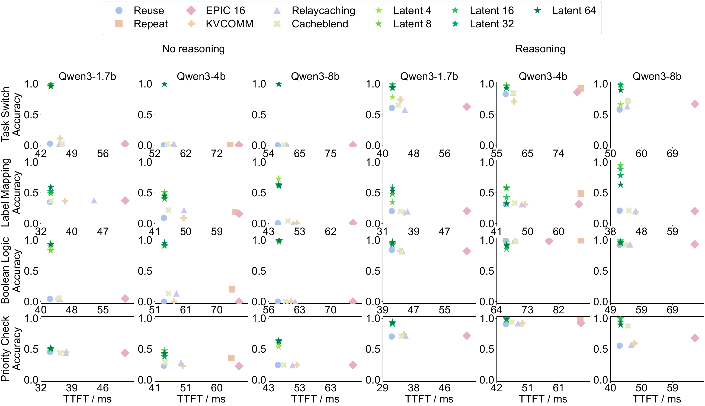

<div align="center">

<h1>LatentRemedy</h1>
<h3>Efficient Remedy for Non-Prefix KV Cache Reuse<br>in Multi-Agent Systems</h3>

<p>
  <a href="https://chenzhwsysu57.github.io/">Zhiwei Chen</a><sup>1</sup> &nbsp; <a href="https://raozhongtao.github.io/">Zhongtao Rao</a><sup>1,2</sup> &nbsp; <a href="https://xiuwk0820.github.io/waikit_homepage/">Waikit Xiu</a><sup>1,3</sup><br>
  Yuxiang Zhang<sup>1</sup> &nbsp; Shuting Cui<sup>1</sup> &nbsp; Jian Chen<sup>3</sup> &nbsp; <a href="https://tianxiangzhao.github.io/">Tianxiang Zhao</a><sup>1,*</sup>
</p>

<p>
  <sup>1</sup>The Hong Kong University of Science and Technology (Guangzhou)<br>
  <sup>2</sup>Microsoft &nbsp; <sup>3</sup>The University of Hong Kong<br>
  <sup>*</sup>Corresponding author
</p>

<p><a href="https://github.com/chenzhwsysu57/kvreuse"><strong>Code</strong></a></p>

</div>

<p align="center">
  <a href="assets/accuracy-ttft.png"></a>
</p>

<p align="center"><strong>Accuracy–TTFT balance.</strong> Ours: <strong>Latent n</strong> (n latent tokens).</p>

---

## Run it the vibe-coding way (recommended)

Just clone this repo and ask your Copilot, Codex, or Claude to install the
dependencies for you and run full prefill, direct reuse, Repeat-prefix, or the
baselines under [third_party/RelayCaching](third_party/RelayCaching/).

For example:

> Read the README and set up the main and RelayCaching environments separately.
> Download Qwen3-4B, then run full prefill, direct reuse, Repeat-prefix, and the
> RelayCaching, CacheBlend, and EPIC baselines on all330. Start with a dry run
> and two pairs, keep native thinking disabled, and use separate output directories.
> For Relay batching, switch to batch and use the static-batched execution path.

Third-party code and data retain their original terms; see
[THIRD_PARTY_NOTICES.md](THIRD_PARTY_NOTICES.md).


## Run it the manual way

### 1. Install dependencies and download a model

Use a CUDA-capable GPU and install a CUDA-enabled PyTorch wheel compatible with
your driver. Keep the main and RelayCaching environments separate.

```bash
git clone https://github.com/chenzhwsysu57/kvreuse.git
cd kvreuse
conda create -n latent-remedy python=3.10 -y
conda activate latent-remedy
python -m pip install -r requirements.txt

export MODELSCOPE_CACHE=/path/to/model-cache
python scripts/download_models.py --models 4b --cache-dir "$MODELSCOPE_CACHE"
export MODEL_PATH=/path/to/downloaded/Qwen3-4B
```

Set `MODEL_PATH` to the directory reported by the download script. Adapter entry
points accept `--model-path`; [run.py](run.py) uses the ModelScope cache layout
under `MODELSCOPE_CACHE`. Models and adapter checkpoints are not included.

For RelayCaching, CacheBlend, and EPIC:

```bash
conda create -n latent-remedy-relay python=3.12 -y
conda run -n latent-remedy-relay python -m pip install -r requirements-relay.txt
export RELAY_PYTHON=/absolute/path/to/envs/latent-remedy-relay/bin/python
```

The required third-party source is included; no submodule setup is needed.

### 2. Choose a dataset

| Alias | Paired records | Dataset |
|---|---:|---|
| `argkp` / `deal` / `job` | 110 each | Real-world evaluation |
| `all330` | 330 | ArgKP, Deal, and Job combined |
| `all240` | 7,200 | All 240 synthetic families |
| `train180` | 5,400 | 180 training families |
| `test60` | 1,800 | 60 held-out families |

Each synthetic family has 30 pairs. See [data/README.md](data/README.md) for the
input format and data terms. Use `--input your_data.jsonl` instead of `--dataset`
for custom paired data.

### 3. Run full prefill, direct reuse, or Repeat-prefix

Run these commands in the main environment:

```bash
python run.py --dataset all330 --method full --model 4b \
  --reasoning no --kv-mode all --batch-size 4

python run.py --dataset all330 --method reuse --model 4b \
  --reasoning no --kv-mode all --batch-size 4

python run.py --dataset all330 --method repeat-prefix --model 4b \
  --reasoning no --kv-mode all --batch-size 4
```

- `--kv-mode all`: both A/B full-prefill sides or both cross-reuse directions.
- `--reasoning yes`: explicit reasoning prompts; both modes keep Qwen's
  `enable_thinking=False`.
- `--limit 2 --dry-run`: inspect a small run's command without loading a model.
- `--output-root`: choose a results directory. Use a fresh directory for each
  configuration; `--overwrite` replaces an existing run.

### 4. Train LatentRemedy

Train from scratch using three pairs per training family:

```bash
python train_prefix_adapter_repeat.py \
  --input data/benchmark/generated240/train_180classes_30each.jsonl \
  --model 4b --model-path "$MODEL_PATH" --output results/adapter_train180 \
  --train-records-per-dataset 3 --train-reasoning no \
  --teacher-mode full --teacher-trace generated \
  --latent-tokens 16 --adapter-bottleneck 256 --epochs 1 --train-batch-size 4
```

This minimal example uses generated full-prefill teacher traces. For all240
training, replace the input with
[data/benchmark/generated240/full_240classes_30each.jsonl](data/benchmark/generated240/full_240classes_30each.jsonl)
and choose another output directory. Keep `--train-records-per-dataset 3` for
three pairs per family; `--use-all-records` instead trains on the complete pool.
Test60 is held out only when training on train180.

### 5. Evaluate LatentRemedy

```bash
python latent_remedy/eval_prefix_adapter_repeat.py \
  --checkpoint results/adapter_train180/latest_prefix_adapter.pt \
  --input data/benchmark/generated240/test_60classes_30each.jsonl \
  --model-path "$MODEL_PATH" --output results/adapter_test60 \
  --reasoning no --max-new-tokens 128 --batch-size 4

python latent_remedy/eval_prefix_adapter_repeat.py \
  --checkpoint results/adapter_train180/latest_prefix_adapter.pt \
  --input data/benchmark/benchmark_final240_real_ood_330_20261006.jsonl \
  --model-path "$MODEL_PATH" --output results/adapter_all330 \
  --reasoning no --max-new-tokens 128 --batch-size 4
```

For reasoning evaluation, use `--reasoning yes --max-new-tokens 4096` and a
separate output directory. Use `--help` on the training/evaluation entry points
for additional options.

### 6. Run third-party baselines

On `main`, RelayCaching runs serially. Launch through the main environment and
pass the separate Relay interpreter:

```bash
python run.py --dataset all330 --method relaycaching --model 4b \
  --reasoning no --kv-mode all --batch-size 1 \
  --relay-python "$RELAY_PYTHON" --output-root results/relay_serial
```

Replace `relaycaching` with `cacheblend` or `epic` to run those baselines.
KVCOMM uses `--method kvcomm --batch-size 1` and additionally requires
`--baseline` pointing to the full-prefill sample outputs.

### 7. Run RelayCaching with batching

Switch to `batch` with a clean working tree:

```bash
git switch batch
python run.py --dataset all330 --method relaycaching --model 4b \
  --reasoning no --kv-mode all --relay-python "$RELAY_PYTHON" \
  --relay-execution-path static-batched --batch-size 2 --warmup-batches 1 \
  --output-root results/relay_batch
```

The batching flags are available only on `batch`; its default is still
`official-serial`. Static batching is a diagnostic throughput path, not official
paper TTFT. CacheBlend and EPIC also support this path.

### 8. Check the installation

```bash
python scripts/verify_public_data.py
python -m unittest discover -s tests -v
# On batch, check the legacy-cache tests in the separate Relay environment:
"$RELAY_PYTHON" -m unittest discover -s tests -p 'test_relay*.py' -v
```
